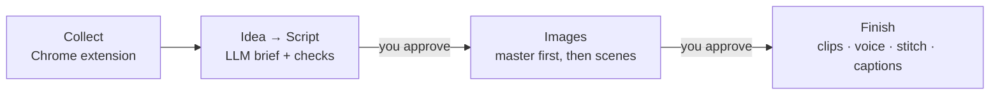

**English** · [Tiếng Việt](README.vi.md)

# AI Content Automation

Turns one TikTok Shop product into a finished Vietnamese affiliate video ad: script, scene images,
video clips, natural voice-over, stitched 9:16 video, captions and hashtags. The user only reads and
approves at two gates: the **script** and the **images**.

> Built for the Vietnamese market. Prompts, the banned-word list, captions and voices are Vietnamese
> on purpose. Code, configuration and the dashboard are English.

## How one video is made



1. **Collect** (Chrome extension in `extension/`): TikTok Shop products and Pinterest reference images
   are sent to `POST /api/v1/products/ingest`.
2. **Idea → Script**: each video follows **one person** from a library (photo uploaded once, reused for
   every product). The generated face matches that photo; clothes and setting change per scene. An LLM
   writes the brief. The script is checked for TikTok Shop banned words and for numbers and claims that
   are not in the product data (including numbers spelled out). The pipeline pauses for you to read it.
3. **Images**: the master image first, then the other scenes. Every image is checked against the real
   product photo and the model photo. A flagged master stops the pipeline.
4. **Finish**: image → video clips, voice-over, 9:16 stitching with stickers, captions timed to the
   speech, and hashtags. Failed or flagged clips are listed under "Scenes that need a look".

The pipeline runs in the background, stores results and the reason it stopped (`product_pipeline_runs`),
and always resumes from what is already done.

## Quick start

Requirements: Python 3.11+, [uv](https://docs.astral.sh/uv/), Node + pnpm, ffmpeg.

```bash
uv sync --extra dev
uv run uvicorn ai_content.entrypoints.api.app:app --reload   # API: http://127.0.0.1:8000
pnpm --dir frontend install --frozen-lockfile
pnpm --dir frontend dev -- --port 4174                         # http://localhost:4174/dashboard/
```

Docker (PostgreSQL, SeaweedFS, API, dashboard): copy `deploy/.env.example` to `deploy/.env`, fill in the
keys, then `just up`.

**Security:** the dashboard and API have **no login**, so they listen on `127.0.0.1` only
(`AIC_HTTP_BIND_ADDRESS`). Do not expose them to the internet. To open them up, enable nginx basic auth
with `deploy/nginx/auth.example.conf` or put them behind a VPN. See [SECURITY.md](SECURITY.md).

## What you need to bring

You supply the model endpoints and keys; nothing is bundled.

| Setting | Used for |
|---|---|
| `AIC_SCREENING_*` | LLM that writes the brief, checks images and clips, reviews the script (OpenAI-compatible) |
| `AIC_IMAGE_*`, `AIC_IMAGE_API` | Image model (`chat` or `edits`) |
| `AIC_VIDEO_*` | Image → video model; `AIC_VIDEO_FRAME_FIELDS` picks the first-frame field |
| `AIC_TTS_*` | Voice-over |
| `AIC_TEXT_EMBEDDING_MODEL` | Matches reference images to scenes (empty = off) |
| `AIC_AI_DATABASE_BACKEND` | `sqlite` (dev) or `postgresql` |

Video models are usually billed per request, so each clip costs real money. See
[docs/model-limits.md](docs/model-limits.md) for the limits measured so far.

Default ad rules live in `config/creative_knowledge/product_ad.json` and load at startup. If you edit
the file, change its `bootstrap_id`; a test reminds you.

## Responsible use

- Use a person's face only with their consent. The dashboard asks you to confirm you have the rights.
- Label AI-generated content as TikTok requires.
- The extension collects pages from TikTok Shop and Pinterest while you are logged in. Check their terms
  of service before you use it. You are responsible for how you use it.
- Check your music and voice files for licensing. Confirm the licence of `config/default_bgm.wav` and of any voice files you add.

## Development

Run in Docker (ffmpeg and fonts included, same on every machine):

```bash
just test            # or: just test tests/test_stickers.py
just lint
```

Or directly on your machine (tests that need ffmpeg are skipped if it is missing):

```bash
uv run ruff check .
uv run pytest
pnpm --dir frontend lint && pnpm --dir frontend test && pnpm --dir frontend build
```

After editing `baml_src/`, regenerate the client with `uv run baml-cli generate` (never edit
`adapters/baml_client` by hand). PostgreSQL migrations are in `migrations/`; SQLite creates its tables
on open. See [CONTRIBUTING.md](CONTRIBUTING.md).

## Docs

Most design notes are in Vietnamese.

- [docs/video-ads-pipeline.md](docs/video-ads-pipeline.md): original design of the image → clip → video flow.
- [docs/model-limits.md](docs/model-limits.md), [docs/affiliate-vietnam.md](docs/affiliate-vietnam.md),
  [docs/reference-corpus-and-content-plan.md](docs/reference-corpus-and-content-plan.md)
- [frontend/DEVELOPMENT.md](frontend/DEVELOPMENT.md), [extension/README.md](extension/README.md)

## License

[MIT](LICENSE)
